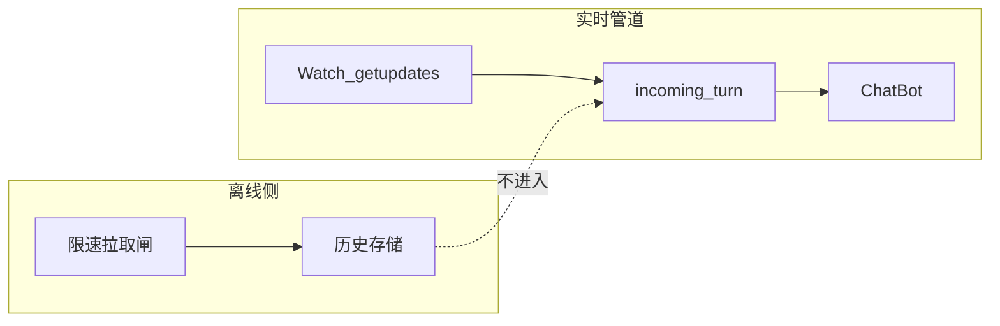

# 同类仓库对照：SnowLuma（survey）

> 只借鉴**边界与形状**。禁止把对方源码搬进本仓；本轮与观察期内**不改收发**。  
> 对照定位：[`SnowLuma/SnowLuma`](https://github.com/SnowLuma/SnowLuma) `main` @ `3bd74acb60e45fed7fa0451be11c54905dee0670`

## 对方是什么

QQ 客户端的 TypeScript 互操作运行时：原生会话 → OneBot v11 动作/事件 → WebSocket / HTTP / WebUI / SDK / MCP。

与本仓**同层**的是会话桥与事件边界。人设、群文化、知识库不在该仓。

## 许可（勿误当 OSI 开源）

- 源码可见、非商业；**不是** OSI 开源。
- 商业使用，以及公开发布修改版或衍生版，须事先书面授权。
- 原生组件（`snowluma-*.node` / `.dll` / `.so`）专有。
- 全文：[LICENSE](https://github.com/SnowLuma/SnowLuma/blob/main/LICENSE)

本仓只记边界结论，不复制其代码或原生组件。

## 可学功能说明（本仓术语）

四条都是**边界**，不是「把 OneBot / MCP 搬过来」。状态标签：

| 标签 | 含义 |
|------|------|
| **已有** | 本仓已具备等价能力 |
| **守住** | 已有正确形状；禁止倒退（例如用正文猜 self） |
| **以后** | 观察期结束后另开任务才考虑；**现在不做** |

### 1. 历史进存储，不进当轮回复 — **以后**

**对方做什么**

- `packages/onebot/src/history-persistence.ts`：`persistHistoryEvent` 只落库，不进实时事件管道。
- `packages/core/src/bridge/apis/history-request-gate.ts`：历史请求串成一队，两次真发网间隔 ≥ 设定值。

**本仓要防什么**

若补「可见窗外」旧消息，容易误当成新消息进入 [`bot/channel.py`](../../bot/channel.py) 的 `incoming_turn` → 触发回复 / 写入印象。

**本仓现状**

- 实时：Watch / openclaw `getupdates` → `SeenMessage` → `incoming_turn`。
- 上下文：桥上 ReadLatest / ReadContext（openclaw 上 ReadContext 曾 UNIMPLEMENTED，宿主软降级为空）。
- **没有**独立历史库管道，也没有历史请求限速闸。

**以后若做：形状**

限速拉取 → 单独落盘 → **禁止**进入 `incoming_turn` / impression。观察期内不落地。

### 2. 认「自己发的」用会话身份，不用正文 — **已有 / 守住**

**对方做什么**

- `packages/onebot/src/self-sent-event.ts`：身份 = 消息类型、会话、序号、`message_id`，再加时间窗。
- `packages/onebot/src/event-filter.ts`：默认不把 `message_sent` 报给上层当对方消息。

**本仓锚点**

- [`bot/eyes.py`](../../bot/eyes.py)：`SeenMessage.from_self`、`message_id`。
- [`bot/channel.py`](../../bot/channel.py)：`should_handle` 对 `from_self` 直接丢弃。
- openclaw 入站已带 `from_self` / `message_id`（见 Callus `docs/openclaw.md`）。

**可学点**

**守住**这条线。**禁止**用预览正文去前缀猜「是不是自己发的」。这不是新功能。

### 3. 媒体字节留磁盘，模型只看短引用 — **已有一半 / 以后收紧**

**对方做什么**

- `packages/mcp/README.md`、`AGENT_FEATURES.md`：下载落盘并校验 SHA-256；返回路径、大小、哈希；不把文件 Base64 交给模型。回复是独立字段。

**本仓锚点**

- [`bot/eyes.py`](../../bot/eyes.py)：`MediaAttachment` 已有 `path`、`sha256`。
- [`bot/channel.py`](../../bot/channel.py)：`IncomingTurn.image_paths` 只传路径；`quotes_bot` **恒为假**（无引用事件）。
- [`bot/llm/client.py`](../../bot/llm/client.py)：仍会把本地图读成 `data:` Base64 给 vision（与 d5「表情图 base64 送模型」一致）。

**冲突与以后形状**

契约层已是「路径 + 哈希」；模型侧仍整段 base64 —— 列为**以后收紧**，观察期内**不改**。收紧后：模型只见短引用（路径 / 哈希 / 说明）；被引用才回须等桥给出引用事件；此前 `quotes_bot` 保持假。

### 4. 操作面默认只读，发送另开闸 — **以后（若做调试面）**

**对方做什么**

MCP：默认动作文档；读/写按动作分类；未知动作拒绝；`preview_message` 只出草稿；回执 ≠ 对方已显示。

**本仓锚点**

闲聊主路径：[`bot/eyes.py`](../../bot/eyes.py) `WeChatEyes` + [`bot/runner.py`](../../bot/runner.py)，**不是** OneBot 动作表。

**可学点**

若以后加调试面：目录、读/写分离、预览、未知拒绝。**不要**把闲聊脑改成动作表。不是立刻加 MCP。

## 对方文件对照表（摘要）

| # | 对方路径 | 本仓标签 |
|---|----------|----------|
| 1 | `history-persistence.ts` / `history-request-gate.ts` | **以后** |
| 2 | `self-sent-event.ts` / `event-filter.ts` | **已有 / 守住** |
| 3 | MCP README / AGENT_FEATURES | **已有一半 / 以后收紧** |
| 4 | MCP 读/写闸与 preview | **以后（调试面）** |

## 已经同构，不必重做

对方 `RoadMap.md`：Common / 协议转换 / Core API / Bridge  
≈ 本仓 `bot/eyes.py`、`bot/hands.py`、`bot/chat.py`。

新能力加在**眼睛**上。账号发现用事件或人手刷新，不做周期扫进程。

## 留在对方仓里（不移植）

- `packages/bridge` 的进程挂钩与登录库
- OneBot 禁言、群文件、空间
- 多账号并行

## 对方写的参考来源（本次未拆）

- [LagrangeDev/LagrangeV2](https://github.com/LagrangeDev/LagrangeV2)
- [NapNeko/NapCatQQ](https://github.com/NapNeko/NapCatQQ)
- OneBot v11：[botuniverse/onebot-11](https://github.com/botuniverse/onebot-11)

## 观察期约束（与 risk 泳道一致）

至 **2026-10-27 17:30**：不扫码、不挂机、不接群、不开 GUI。本 survey **不改收发**。
